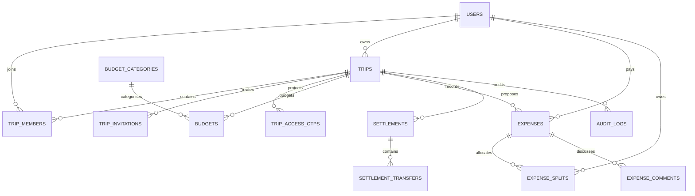

# SplitTrip domain model

## Core records

- `users`: account identity and credentials.
- `trips`: visibility, owner, destination, dates, currency and headline budget.
- `trip_members`: membership, role and private access verification timestamp.
- `trip_invitations`: email invitation token hash and expiry lifecycle.
- `trip_access_otps`: hashed one-time codes, expiry, attempt counter and consumption timestamp.
- `budget_categories`, `budgets`: category-based planned budget lines.
- `expenses`: full amount, payer, creator, category, currency, time and idempotency key.
- `expense_splits`: per-person allocation in minor units and optional comment.
- `expense_comments`: discussion on an expense.
- `settlements`, `settlement_transfers`: proposed transfers and future confirmed payment history.
- `audit_logs`: security and financial activity metadata.

## Roles

- Owner: owns the trip and can administer it.
- Admin: can administer trip configuration and invitations.
- Member: can contribute expenses/comments and participate in settlement.
- Viewer: read-only role, to be enforced across every write route before launch.

## Private-trip access

Membership and private-trip authorization are separate. A member must have active membership and a recent OTP verification. The OTP is hashed, expires after the configured period, is single-use and has a bounded number of attempts. Each private resource endpoint must perform the same authorization check. The current API code implements this on trip reads, expenses, comments and settlement operations; expand the policy middleware coverage before launch.
